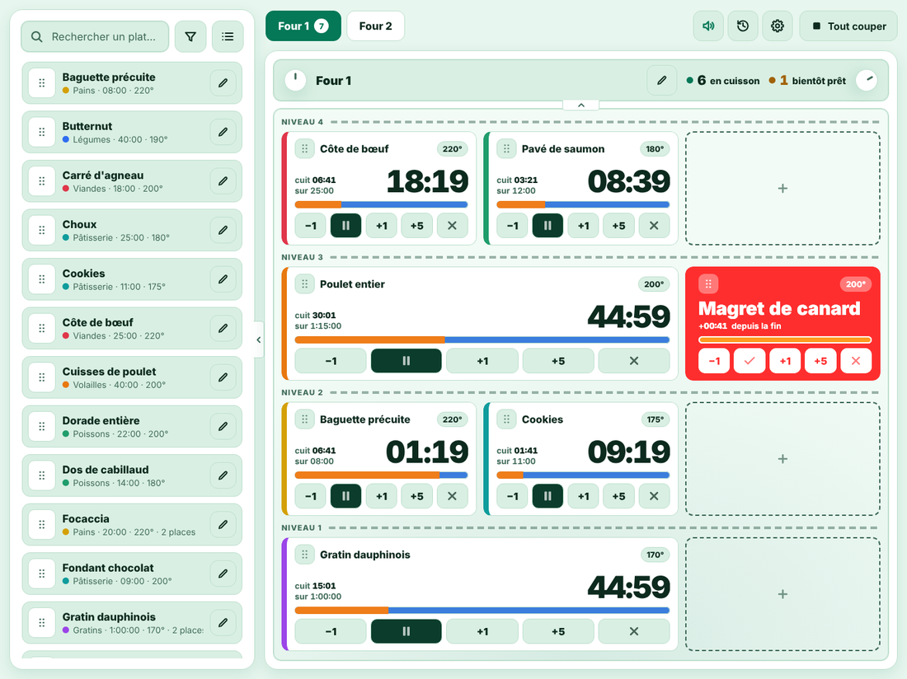
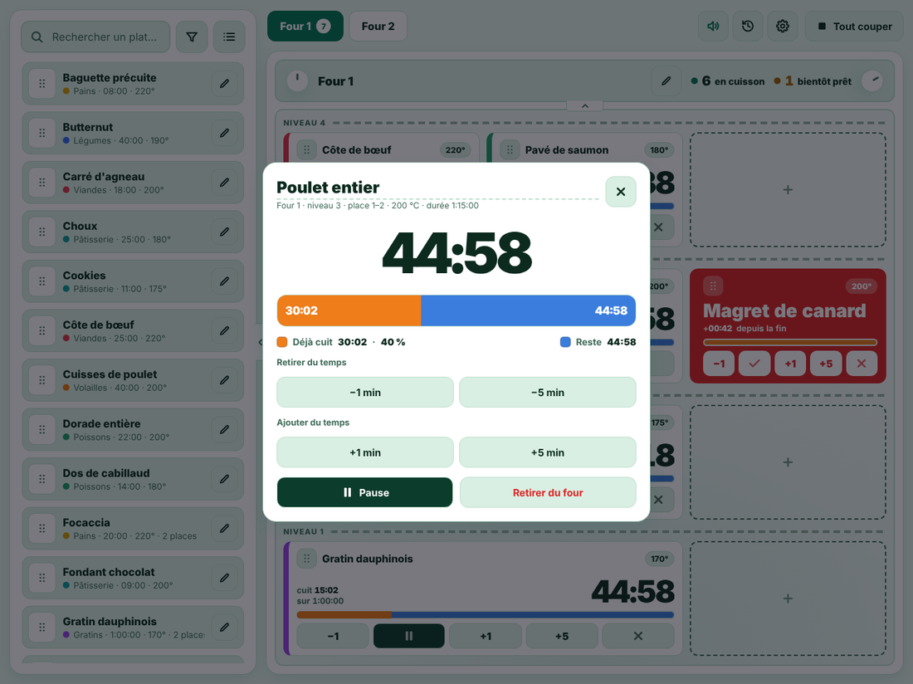
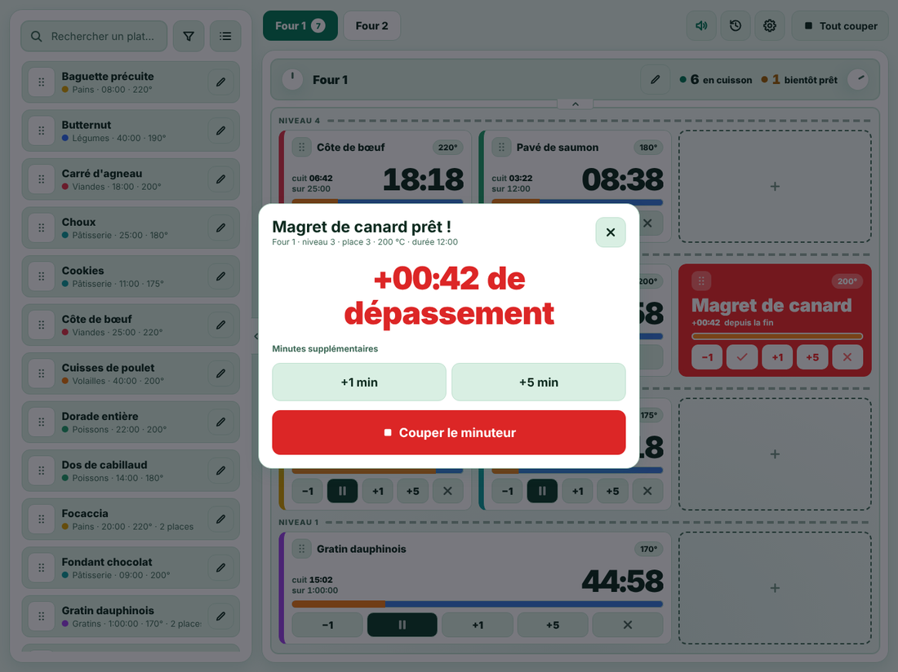
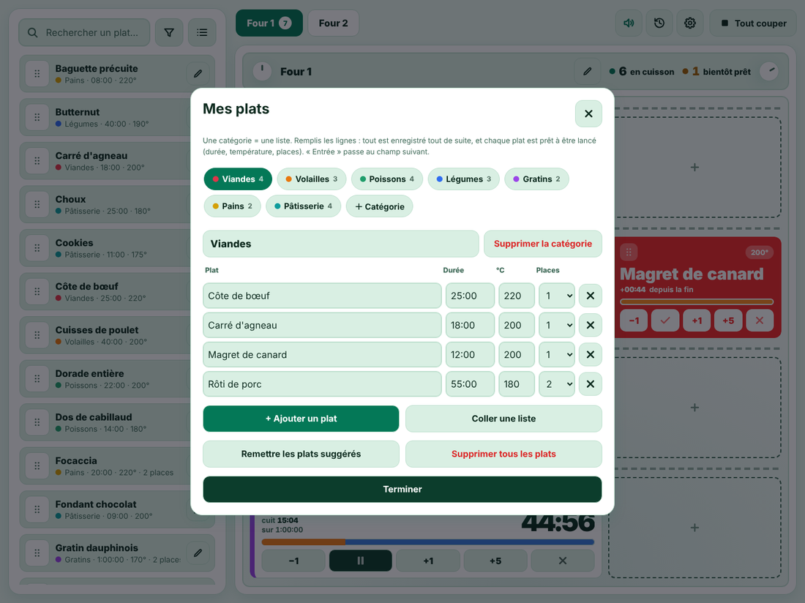
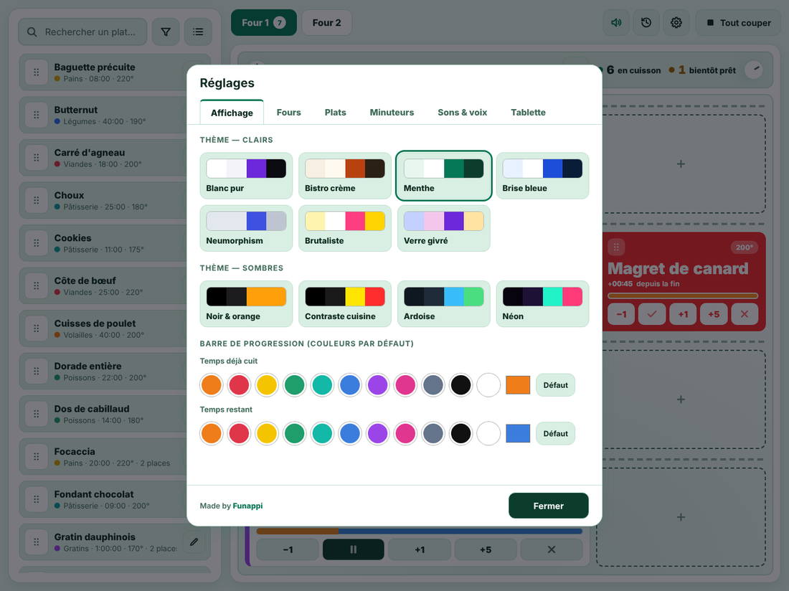
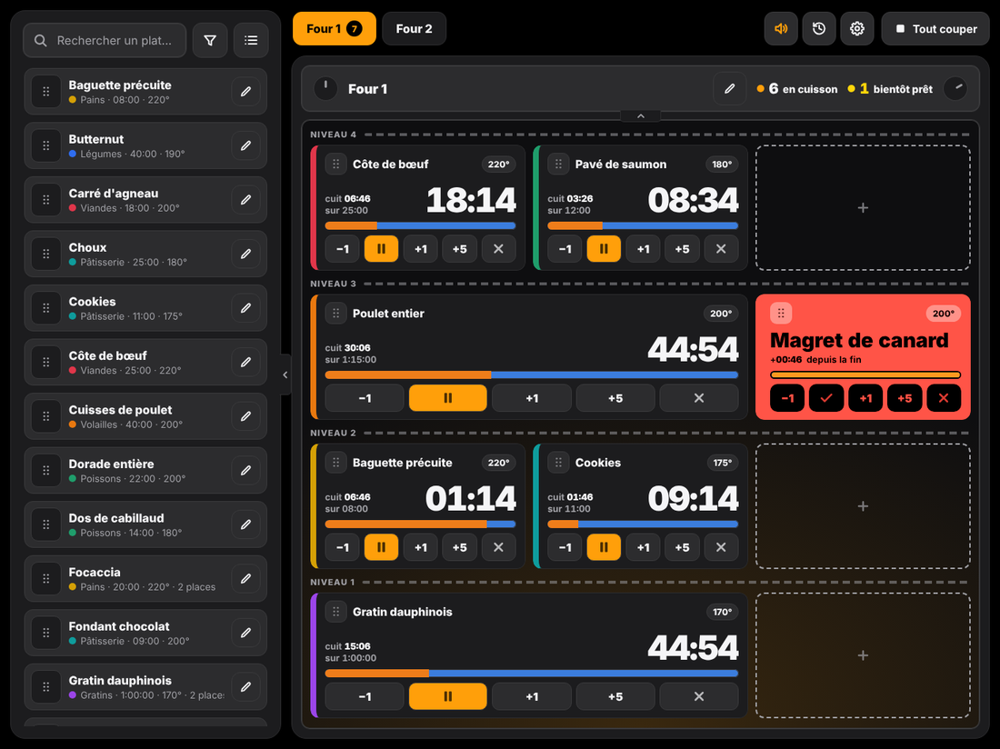
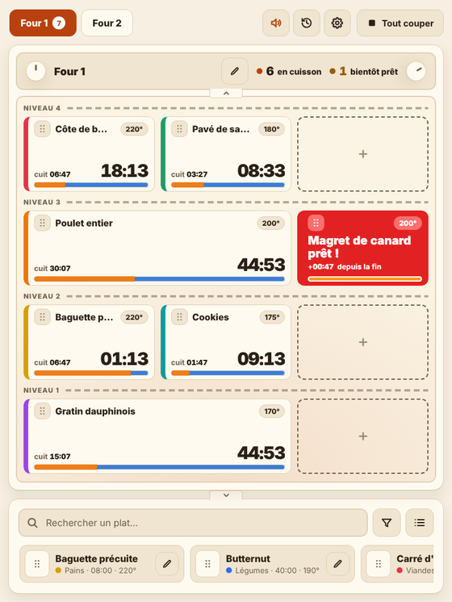

  

# FourTimer — multi-minuteur de four de restaurant ⏲️🔥

FourTimer est une application web installable (PWA) qui affiche les fours d'une cuisine de restaurant, niveau par niveau et place par place. On glisse un plat sur une place libre et son minuteur démarre : temps déjà cuit, temps restant, alerte visuelle, bip et annonce vocale quand c'est prêt. Pensée d'abord pour l'**iPad**, elle marche aussi sur les tablettes et téléphones **Android**, **100 % hors ligne**.

  
  
  
  
  
  

<h3 align="center"><a href="https://funappi.github.io/FourTime/">👉 Ouvrir l'application</a></h3>

  

  
  

🎬 **[Voir la vidéo de présentation complète](docs/presentation.mp4)** (3 min 50, toutes les fonctionnalités et réglages)

## 📖 Sommaire

- [Fonctionnalités principales](#-fonctionnalités-principales)
- [Installer sur une tablette ou un téléphone](#-installer-sur-une-tablette-ou-un-téléphone)
- [Technologies utilisées](#️-technologies-utilisées)
- [Alertes et arrière-plan](#-alertes-et-arrière-plan)
- [Captures](#-captures)
- [Licence](#-licence)

## ✨ Fonctionnalités principales

### 1. 🔥 Le four visuel
* **Plusieurs fours** (un onglet chacun), avec un **nom** et une **couleur** modifiables.
* **Nombre de niveaux** et **nombre de places de chaque niveau** réglables séparément.
* **Glisser-déposer** un plat sur une place libre, ou toucher le plat puis la place (pratique avec des gants).
* Un plat peut occuper **plusieurs places** (ex. un gratin sur 2 places).
* **Déplacer** un minuteur en cours d'une place à l'autre sans perdre le temps.
* Panneau du four : nombre de plats **en cuisson** et **bientôt prêts**.
* **Panneaux rétractables** (languettes avec flèche) pour donner toute la place au four.

### 2. ⏱️ Les minuteurs
* Sur chaque carte : **temps restant** au-dessus de la barre, **temps déjà cuit** de l'autre côté.
* Boutons **− / +** configurables (jusqu'à 4 valeurs, en secondes ou en minutes), pause / reprise.
* Fenêtre de détail : grande **barre de progression à deux couleurs**, **renommer** le minuteur en cours (ex. numéro de table).
* Plat prêt : carte rouge « *Magret prêt !* », bip et **voix** (désactivable) ; un toucher propose des **minutes supplémentaires** ou **couper le minuteur**.
* **Tout couper** pour vider le four affiché d'un coup.
* Les minuteurs se basent sur l'heure réelle : ils restent justes même si l'app a été fermée.

### 3. 🍽️ Mes plats
* Plats préréglés par **catégorie** (durée, température, nombre de places).
* **Recherche** instantanée et **filtre** par catégorie.
* Éditeur de **listes faciles à remplir** ligne par ligne, catégories modifiables.
* **Coller une liste** depuis un texte ou Excel (un plat par ligne).
* Création d'un plat directement depuis la recherche.
* Transfert de tous les plats vers une autre tablette (copier / importer).

### 4. 📋 Historique par soirée
* Tout ce qui a été sorti ou coupé, heure par heure, avec le four, le niveau, le temps cuit et le temps prévu.
* Export **CSV** (traçabilité HACCP, comptage des plats).

### 5. 🎨 Réglages en onglets
* **Affichage** : 11 thèmes clairs et sombres (Blanc pur, Bistro crème, Menthe, Neumorphism, Noir & orange…), couleurs de la barre de progression.
* **Fours**, **Plats**, **Minuteurs**, **Sons & voix**, **Tablette** (écran toujours allumé, alertes, installation).

## 📲 Installer sur une tablette ou un téléphone

L'application s'ouvre depuis le lien, puis s'installe comme une vraie app (icône sur l'écran d'accueil, plein écran, sans barre de navigateur). Il faut l'ouvrir **une première fois avec internet**, ensuite elle fonctionne **sans connexion**.

| Appareil | Comment faire |
|---|---|
| **iPad / iPhone** | Ouvrir le lien dans **Safari** → bouton **Partager** → **Sur l'écran d'accueil** |
| **Tablette / téléphone Android** | Ouvrir le lien dans **Chrome** → menu **⋮** → **Installer l'application** (ou la bannière « Installer ») |
| **Ordinateur** | Chrome ou Edge → icône d'installation dans la barre d'adresse |

Les données (fours, plats, historique) restent enregistrées **sur l'appareil**, dans le navigateur. Aucun compte, aucun serveur.

Pour une version native (APK Android, App Store / TestFlight sur iPad), voir [docs/INSTALLATION.md](docs/INSTALLATION.md) (emballage avec Capacitor).

## 🛠️ Technologies utilisées

Le projet tient en **un seul fichier `index.html`**, sans framework ni dépendance externe, ce qui le rend léger et utilisable hors ligne.

* **HTML5 / CSS3 / JavaScript (ES2020)** : interface, thèmes en variables CSS, *container queries* pour adapter les cartes à leur taille.
* **PWA** : `manifest.webmanifest` + **Service Worker** (`sw.js`) qui met toute l'app en cache.
* **LocalStorage** : sauvegarde des fours, plats, minuteurs, réglages et historique.
* **Web Speech API** : annonces vocales ; **Web Audio** pour le bip.
* **Wake Lock**, **Notifications**, **Media Session** : écran allumé et alertes quand l'app est en arrière-plan.
* Pont prêt pour **Capacitor Local Notifications** (alertes même app fermée en version native).

## 🔔 Alertes et arrière-plan

* **App ouverte** (usage normal en cuisine, écran toujours allumé) : bip, voix et alerte visuelle.
* **App en arrière-plan** : notification système quand un plat est prêt (après avoir activé les alertes dans Réglages › Tablette).
* **App complètement fermée** : seule la version native (Capacitor) peut sonner. Les minuteurs restent quand même justes à la réouverture.

## 🖼️ Captures

  
  

  
  

## 📜 Licence

Ce projet est distribué sous la licence [PolyForm Noncommercial 1.0.0](LICENSE) : utilisation, modification et partage libres pour tout **usage non commercial**.

**Usage commercial (restaurants, revente) : contacte-moi pour une licence séparée** — [Funappi](https://github.com/funappi).
